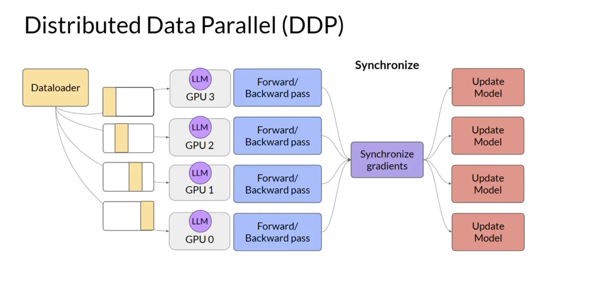

# Distributed Data Parallel (DDP)
At its core, Distributed Data Parallel (DDP) operates on a paradigm called **Single-Program Multiple-Data (SPMD)**. This means the exact same training script and model run simultaneously across all your GPUs, but each GPU processes a different slice of your dataset.

Because the model fits entirely on a single GPU, the architecture's main job is simply to keep the model weights perfectly synchronized across all GPUs while they chew through different data in parallel.

Here is a high-level view of how DDP orchestrates this across a single training step:

### The 5-Step Architecture Lifecycle

To understand DDP comprehensively, let's break down exactly what happens under the hood during one complete training iteration.

#### 1. Initialization: Model Replication

When you wrap your model with `DDP(model, device_ids=[local_rank])`, PyTorch takes the model weights from "Process 0" (usually GPU 0, acting as the lead coordinator) and broadcasts them to GPUs 1, 2, and 3. **Every GPU starts with an exact, identical replica of the model.**

#### 2. Data Partitioning: Slicing the Batch

During training, your `DistributedSampler` ensures that no two GPUs see the same images (or text) at the same time. If your global batch size is 128 across 4 GPUs, the Dataloader feeds a unique mini-batch of 32 samples to GPU 0, a different 32 to GPU 1, and so on.

#### 3. Forward Pass: Independent Compute

Each GPU performs the forward pass independently. It feeds its 32 samples through its local replica of the model to calculate the loss. At this stage, the GPUs do not communicate with each other at all. Because the inputs were different, each GPU will compute a **different loss value**.

#### 4. Backward Pass: The Synchronization Magic (All-Reduce)

As the backward pass computes gradients (the directions to adjust the weights), DDP steps in to synchronize them. It doesn't wait for the entire backward pass to finish. Instead, it groups gradients into "buckets" (typically 25MB each).

As soon as a bucket is full of computed gradients, DDP triggers an operation called **All-Reduce** across the network (using the NCCL backend). All-Reduce takes the gradients from GPU 0, 1, 2, and 3, averages them together, and sends the averaged gradients back to every GPU. By the time the backward pass finishes, **every GPU holds the exact same averaged gradients**.

#### 5. Optimizer Step: Identical Updates

Finally, `optimizer.step()` is called. Because every GPU started with the exact same weights (Step 1) and just received the exact same averaged gradients (Step 4), they will all update their local model weights by the exact same mathematical amount.

The models remain perfectly identical for the next step, and the cycle repeats.

---

**The Secret to DDP's Speed:**

The reason DDP is so efficient is that it **overlaps communication with computation**. It doesn't wait for the backward pass to finish before syncing gradients. By using buckets, it syncs the gradients of the deeper layers while the GPUs are still busy calculating the gradients for the shallower layers.