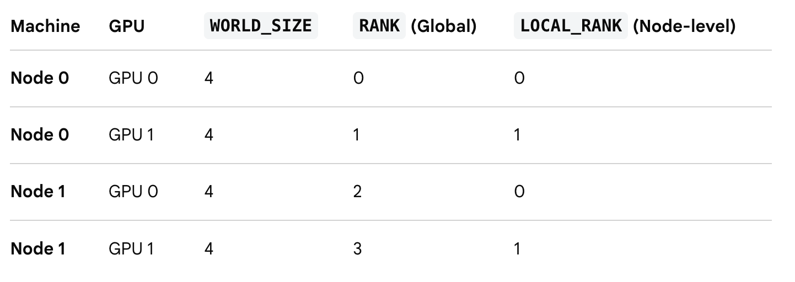

# DDP Terms
## WORLD_SIZE, RANK, and LOCAL_RANK
In PyTorch distributed training, WORLD_SIZE is the total number of processes participating in a training job, while RANK is the unique global ID assigned to each individual process. Together, these environment variables allow multiple GPUs across one or more machines to coordinate and communicate.

### Core Definitions
- **WORLD_SIZE**. This integer represents the total count of workers (processes) across all machines in your distributed setup. It is calculated by multiplying the number of nodes by the number of processes per node (nnodes * nproc_per_node).
- **RANK (Global Rank)**. This integer uniquely identifies a specific process across the entire cluster, ranging from 0 to WORLD_SIZE - 1. RANK=0 is typically designated as the main or master process responsible for tasks like logging metrics or saving model checkpoints.
- **LOCAL_RANK**. Unlike global RANK, this integer identifies a process only within its specific physical machine (node). It ranges from 0 to the number of GPUs on that single machine minus one, and is commonly used to assign a process to a specific local GPU (cuda:LOCAL_RANK).

### Multi-Node Example
Imagine you are training a model on 2 machines (nodes), and each machine has 2 GPUs (1 process per GPU):

### How They Are Used in Practice
Launch utilities like `torchrun` automatically inject `RANK`, `WORLD_SIZE`, and `LOCAL_RANK` into your environment so your script can read them via Python's `os.environ`.
- **Initializing communication**. PyTorch's Distributed Communication Package uses `RANK` and `WORLD_SIZE` inside `dist.init_process_group()` so every GPU knows how many peers exist and how to address them.
- **Splitting data**. Tools like `DistributedSampler` use `RANK` and `WORLD_SIZE` to slice a dataset into equal parts, ensuring each process trains on a distinct subset of data during an epoch.
- **Preventing duplicate work**. Developers wrap saving and logging logic in `if rank == 0:` blocks so multiple processes do not overwrite the same checkpoint file simultaneously.

