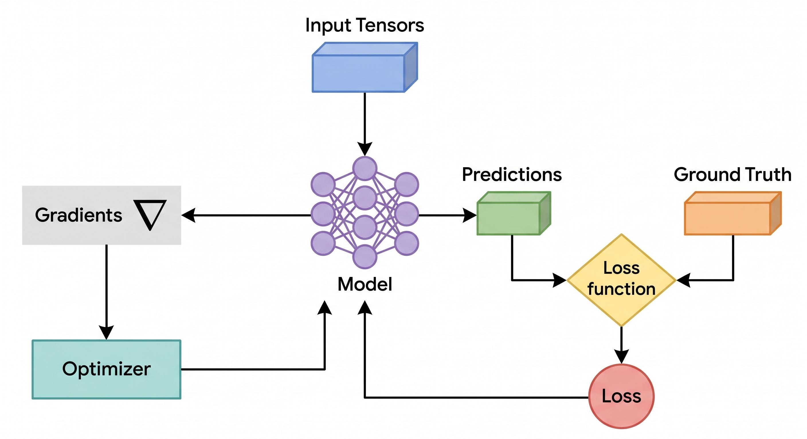

# Torch Autograd

```
Since I really want to understand PyTorch comprehensively, please dissect `loss.backward()`
```

When you call `loss.backward()`, PyTorch invokes its Autograd engine to automatically execute the exact chain-rule math you manually wrote in your custom `backward()` method. It achieves this by traversing a hidden, dynamically generated map of your operations called a **Computational Graph**.

Here is a breakdown of what exactly happens under the hood when that single line of code runs.

### 1. The Prerequisite: `requires_grad=True`

For PyTorch to know what it needs to calculate derivatives for, a Tensor must have its `requires_grad` property set to `True`. When you instantiate an `nn.Linear` layer, PyTorch automatically creates weight and bias tensors and sets `requires_grad=True` on them. These are called **leaf nodes** because they are at the very beginning of the graph. Your input data (`X`), however, has `requires_grad=False` because you don't need to optimize the data itself.

### 2. The Forward Pass: Building the Graph

In your custom code, your `forward()` method just computed numbers. In PyTorch, the forward pass does two things simultaneously:

* **Computes the output values** (just like your code).
* **Builds a Directed Acyclic Graph (DAG)** in the background.

Every time PyTorch performs a mathematical operation on a tensor that requires gradients, it creates a new tensor and attaches a `grad_fn` (Gradient Function) to it. For example, if it adds a bias, the resulting tensor gets an `AddBackward` function attached. If it passes through a sigmoid, it gets a `SigmoidBackward` function. This graph is PyTorch's memory of exactly *how* the output was created.

### 3. The Execution: `loss.backward()`

When you call `loss.backward()`, the Autograd engine kicks in and does the following:

* It starts at the scalar `loss` node.
* It looks at the `grad_fn` of that node and computes the local derivative.
* It asks: *"What tensors were used as inputs to this function?"*
* It moves backward to those input tensors, looks at *their* `grad_fn`s, multiplies the local derivative by the incoming gradient (the Chain Rule), and continues this process backward through the entire DAG.

### 4. The Destination: The `.grad` Attribute

In your scratch-built network, you saved your gradients into explicit variables like `self.dL_dw1` and `self.dL_db1`.

PyTorch takes a cleaner approach. When the backward traverse reaches a leaf node (your weights and biases), it takes the final calculated gradient and stores it directly inside that specific tensor's `.grad` attribute.

* Your manual `self.dL_dw1` is equivalent to `model.hidden.weight.grad[0, 0]` in PyTorch.
* When you later call `optimizer.step()`, the optimizer simply loops through all parameters and subtracts `learning_rate * parameter.grad` from the parameter's actual data.

### 5. The Catch: Gradient Accumulation

Autograd is designed to **add** the newly computed gradients to whatever is already sitting in the `.grad` attribute, rather than overwriting it. This is highly useful for specific advanced techniques (like training on huge batches by accumulating smaller ones), but it means that in standard training, your gradients will compound endlessly if you don't clear them out.

This is exactly why `optimizer.zero_grad()` must be called *before* the forward pass in your training loop. It resets all the `.grad` attributes back to zero so the new batch gets a fresh calculation.


```
Let's focus on `self.sigmoid`, how does the Autograd engine compute gradient for it?
```

When Autograd reaches a `nn.Sigmoid()` operation during the backward pass, it invokes a specific C++ function called `SigmoidBackward` to apply the chain rule using the exact mathematical derivative you wrote in your custom `d_sigmoid` function, but with a major optimization.

Here is the step-by-step breakdown of how PyTorch's engine computes it:

* **The Forward Pass Optimization (Caching):** As you noted in your code, the derivative of the sigmoid function $\sigma(x)$ is $\sigma(x)(1 - \sigma(x))$. Computing the math for $\sigma(x)$ requires calculating exponentials ($e^{-x}$), which is computationally expensive. To avoid doing this math twice, PyTorch **caches the output tensor** during the forward pass. If the forward pass is $y = \sigma(x)$, PyTorch saves the resulting $y$ values in memory.
* **Receiving the Upstream Gradient:** During `loss.backward()`, the Autograd engine traverses backward until it hits the sigmoid node. It arrives carrying the gradient from the layer immediately ahead of it (like the output layer or the loss function). Let's call this incoming gradient the "upstream gradient" ($\frac{\partial L}{\partial y}$).
* **Calculating the Local Gradient:** Because PyTorch cached the output $y$ during the forward pass, it does not need to recalculate the sigmoid function. It simply retrieves the cached $y$ tensor and computes the local gradient using basic arithmetic: $y \times (1 - y)$.
* **Applying the Chain Rule:** The `SigmoidBackward` function multiplies the upstream gradient by the local gradient: $\frac{\partial L}{\partial x} = \frac{\partial L}{\partial y} \cdot y(1 - y)$. This is the exact equivalent of your line `dL_dy_pred * d_sigmoid(self.o1_sum)`.
* **Passing it Down:** This newly calculated $\frac{\partial L}{\partial x}$ becomes the new upstream gradient. PyTorch passes it backward to the preceding node in the computational graph (your `nn.Linear` layer), where it is used to calculate the final gradients for your weights and biases.

Because PyTorch caches intermediate forward tensors specifically for their corresponding backward formulas, operations like Sigmoid and ReLU compute their derivatives almost instantly without re-evaluating the underlying math.

```
How does Autograd compute the gradients for the weights and biases inside the nn.Linear layer after receiving the gradient from the sigmoid?
```

When Autograd steps backward from the Sigmoid node into your `nn.Linear` layer, it arrives carrying the upstream gradient—let's call it $\frac{\partial L}{\partial Y}$. PyTorch then uses the underlying C++ function (typically `AddmmBackward`) to compute three distinct gradients using highly optimized matrix calculus.

To understand exactly what Autograd does, we first look at the forward equation of `nn.Linear`, which is **$Y = XW^T + b$**.

* **$X$** is the input data (or the output of a previous layer).
* **$W$** is the weight matrix.
* **$b$** is the bias vector.

Just like Sigmoid cached its output, the `nn.Linear` layer **caches the input tensor $X$** during the forward pass because it needs it to calculate the derivatives later.

When the upstream gradient $\frac{\partial L}{\partial Y}$ arrives, Autograd immediately splits the calculation into three paths:

### 1. Gradients for the Weights ($W$)

To update the weights, Autograd calculates how much the weights contributed to the error.

* **The Math:** $\frac{\partial L}{\partial W} = \left(\frac{\partial L}{\partial Y}\right)^T \cdot X$
* **What happens:** PyTorch performs a matrix multiplication between the transposed upstream gradient and the cached input $X$. The result is accumulated directly into `layer.weight.grad`.
* **In your custom code:** This is the highly optimized, fully vectorized equivalent of you writing `self.dL_dw1 = ... * x[0]`. Instead of doing it one scalar at a time, PyTorch computes the gradients for all weights in the layer simultaneously across the entire batch.

### 2. Gradients for the Biases ($b$)

The bias is added directly to the output, so its local derivative is just $1$.

* **The Math:** $\frac{\partial L}{\partial b} = \sum \frac{\partial L}{\partial Y}$
* **What happens:** By the chain rule, Autograd simply takes the upstream gradient $\frac{\partial L}{\partial Y}$ and sums it across the batch dimension (since the same bias is applied to every item in the batch). The result is stored in `layer.bias.grad`.
* **In your custom code:** This perfectly matches your manual calculation `self.dL_db1 = ... * 1`, but summed up for the mini-batch.

### 3. Gradients for the Input ($X$)

Autograd isn't finished—it has to keep passing the gradient backward down the chain to previous layers. To do this, it needs to calculate the gradient with respect to the input $X$.

* **The Math:** $\frac{\partial L}{\partial X} = \frac{\partial L}{\partial Y} \cdot W$
* **What happens:** PyTorch multiplies the upstream gradient by the current weight matrix $W$. This creates the *new* upstream gradient that will be passed backward to whatever layer comes before this one.
* **The exception:** If this `nn.Linear` is the very first layer of your network, its input $X$ is just your raw training data. Since your raw dataset has `requires_grad=False`, Autograd skips calculating $\frac{\partial L}{\partial X}$ entirely and stops traversing that branch of the graph, saving computation time.


```
Please draw a DAG for the PyTorchNeuralNetwork
```

In PyTorch, "Acyclic" means the data flows strictly in one direction from inputs to outputs without ever looping back on itself. When you run a forward pass, PyTorch builds this Directed Acyclic Graph (DAG) on the fly, keeping track of exactly which tensors and mathematical operations created your output.

Here is what the DAG looks like specifically for your `PyTorchNeuralNetwork` during the training loop.



### The Computational Graph (DAG) for Your Network

In this diagram, the **tensors** (data, weights, biases) are the nodes, and the **operations** (Linear, Sigmoid, MSE) are the edges connecting them.

```text
       [Input: X]   [hidden.weight]   [hidden.bias]
               \          |           /
                \         |          /
                 v        v         v
               (    Linear Layer 1    )   <-- Attached: AddmmBackward
                          |
                          v
                      [h1_sum]
                          |
                          v
                     ( Sigmoid )          <-- Attached: SigmoidBackward
                          |
                          v
                  [Hidden State: h1]   [output.weight]   [output.bias]
                           \                 |               /
                            \                |              /
                             v               v             v
                           (       Linear Layer 2        )   <-- Attached: AddmmBackward
                                             |
                                             v
                                         [o1_sum]
                                             |
                                             v
                                        ( Sigmoid )          <-- Attached: SigmoidBackward
                                             |
                                             v
                                     [Output: y_pred]      [Target: y_true]
                                             \                    /
                                              \                  /
                                               v                v
                                              (    MSE Loss      )   <-- Attached: MseLossBackward
                                                        |
                                                        v
                                                  [Scalar: loss]

```

### Why "Directed" and "Acyclic"?

1. **Directed:** The arrows only point one way. `X`, weights, and biases flow *into* the Linear operation. The result flows *into* the Sigmoid. You cannot travel backward through the graph during the forward pass.
2. **Acyclic:** There are no cycles or loops. The output `h1` never circles back to become an input for `Linear Layer 1` again.

### How `loss.backward()` Navigates This DAG

When you call `loss.backward()`, PyTorch starts at the very bottom `[Scalar: loss]` and walks backward up the arrows.

It looks at the function attached to each operation (e.g., `MseLossBackward`, `SigmoidBackward`) to calculate the local gradient, and follows the paths all the way back up to the "leaf nodes"—the tensors at the top that have `requires_grad=True` (`hidden.weight`, `hidden.bias`, `output.weight`, `output.bias`).

It deliberately stops at `[Input: X]` and `[Target: y_true]` because you don't need to optimize your dataset, so PyTorch saves time by ignoring those branches.


```
I want to comprehensively and thoroughly understand the interaction between `loss.backward()` and the Autograd engine. Please walk me through step by step for calculating gradient for the Sigmoid node.
```

To understand exactly how Autograd computes the gradient for a specific node like `Sigmoid`, we must look at how PyTorch bridges the gap between the forward operation and the backward chain rule. The engine relies on C++ backend functions and memory caching to execute this flawlessly.

Here is the exact, step-by-step lifecycle of the gradient calculation for a Sigmoid node when you call `loss.backward()`.

### Step 1: The Forward Pass (Context Saving)

Autograd's efficiency in the backward pass is entirely dependent on what happens during the forward pass.
When PyTorch executes `y = torch.sigmoid(x)`, it does not just compute the output. It creates an internal object called a `Node` (specifically, `SigmoidBackward0`) and attaches it to the computational graph.

Because the mathematical derivative of sigmoid ($\sigma'(x) = \sigma(x)(1 - \sigma(x))$) relies on the output value, the Autograd engine deliberately **caches the output tensor `y` in memory**. In PyTorch's C++ backend, this is known as `save_for_backward`. The engine essentially says, *"I will need this exact output tensor later to compute the derivative, so keep it alive."*

### Step 2: The Trigger (`loss.backward()`)

When you execute `loss.backward()`, the Autograd engine awakens. It looks at the `.grad_fn` of the `loss` tensor and begins a topological sort traversal of the Directed Acyclic Graph (DAG) it built during the forward pass. It works its way backward, passing gradients from node to node.

### Step 3: Arrival at the Sigmoid Node

Eventually, the engine traverses back to the `SigmoidBackward0` node.
When Autograd arrives, it brings a crucial piece of data: the **upstream gradient**. This is the gradient of the loss with respect to the *output* of the sigmoid node ($\frac{\partial L}{\partial y}$). In PyTorch backend terminology, this incoming tensor is called `grad_output`.

### Step 4: The Local Derivative Calculation

The `SigmoidBackward0` node now executes its specific C++ function to calculate the local gradient.
Instead of recalculating $e^{-x}$ (which requires expensive exponential math), the node unpacks the cached tensor `y` that it saved during Step 1.

It calculates the local derivative using highly optimized, vectorized tensor arithmetic:


$$\text{Local Gradient} = y \odot (1 - y)$$


*(Note: $\odot$ represents element-wise multiplication).*

### Step 5: The Chain Rule Multiplication

Autograd must now apply the chain rule to find the gradient of the loss with respect to the *input* of the sigmoid node ($\frac{\partial L}{\partial x}$).
It multiplies the incoming `grad_output` by the locally computed derivative:


$$\frac{\partial L}{\partial x} = \text{grad\_output} \odot (y \odot (1 - y))$$

In PyTorch's internal C++ code, this looks conceptually like this:

```cpp
Tensor sigmoid_backward(const Tensor& grad_output, const Tensor& output) {
    return grad_output * output * (1.0 - output);
}

```

This tensor ($\frac{\partial L}{\partial x}$) is the final, complete gradient for this specific node. It is officially called `grad_input`.

### Step 6: Dispatching to the Next Node

The `SigmoidBackward0` node's job is complete. It hands this newly calculated `grad_input` tensor to the Autograd engine.
The engine then looks at the `.next_functions` property of the `Sigmoid` node to see where this data came from originally (for example, the `AddmmBackward` node of your `nn.Linear` layer). Autograd passes this tensor backward down the graph, where it becomes the new `grad_output` for the linear layer, continuing the chain rule all the way down to your weights and biases.


```
>When you execute loss.backward(), the Autograd engine awakens. It looks at the .grad_fn of the loss tensor and begins a topological sort traversal of the Directed Acyclic Graph (DAG) it built during the forward pass. It works its way backward, passing gradients from node to node.

Let's unpack this paragraph. Does the Autograd engine maintain the DAG? How does it know it must start with the loss tensor?
```

Autograd does not have a centralized "brain" that stores a master map of the graph, nor does it inherently know what a "loss" is. The answers to both of your questions lie in PyTorch’s **Define-by-Run** architecture and object-oriented design.

### 1. Does the Autograd engine maintain the DAG?

The Autograd engine does not maintain a static, global blueprint of the DAG. Instead, the graph is **decentralized and built dynamically** on the fly.

The DAG is essentially a web of pointers created during the forward pass, scattered across the memory of your tensors. Here is how it is "maintained":

* **The `grad_fn` property:** Every time you perform a mathematical operation on a tensor with `requires_grad=True`, PyTorch creates a new output tensor. Inside that new tensor, it instantiates a C++ object representing the operation (e.g., `AddBackward`, `SigmoidBackward`) and attaches it to the tensor's `.grad_fn` attribute.
* **The `next_functions` property:** To create the graph, this `.grad_fn` object looks at the input tensors that created it. It grabs pointers to *their* `.grad_fn` objects and saves them in an internal tuple called `next_functions`.
* **The Result:** The DAG is simply a linked list of these `next_functions` pointers. PyTorch "maintains" the graph the same way a chain maintains its length—each link just holds onto the link immediately behind it. When the forward pass is done, the graph is just sitting in memory as a trail of breadcrumbs leading back to your network's weights.

### 2. How does it know it must start with the loss tensor?

The Autograd engine has no concept of "loss", "predictions", or "accuracy". It starts with the loss tensor for one simple reason: **you specifically called the `.backward()` method on it.**

When you write `loss.backward()`, you are executing a method belonging to that specific tensor object. Under the hood, this translates to `torch.autograd.backward(tensors=loss)`.

Here is exactly what that command tells the engine:

1. **The Starting Point:** "Look inside this specific tensor (`loss`), extract its `.grad_fn` (which would be `MseLossBackward`), and make this node the root of your topological sort."
2. **The Initial Gradient:** To start the chain rule, the engine needs an initial $\frac{\partial L}{\partial L}$ value. Because `loss` is a scalar (a 0-dimensional tensor containing a single number), PyTorch automatically assumes the initial gradient is exactly `1.0`. It implicitly creates a tensor `torch.tensor(1.0)` and feeds it into the starting node.
3. **The Traversal:** From there, the engine simply follows the `next_functions` pointers backward, passing the multiplied gradients down the chain until it hits tensors with no `next_functions` (your leaf nodes: the weights and biases).

If you had instead called `h1.backward()` on your hidden layer tensor, the engine would happily start the backward pass from the middle of your network, completely ignoring everything that happened after `h1`.


```
As far as I know there are several optimizers such as SGD, Adam. Usually, the optimizer takes each gradient as input and update each weight using its own formula, right?
```

Yes, that is exactly right. The Autograd engine's job is solely to calculate the gradients and drop them into the `.grad` attributes. The optimizer's job is to take those gradients and apply its own specific mathematical formula to update the weights.

Because different optimizers use different formulas, they take vastly different paths through the "loss landscape" to find the minimum error.

Here is how the update formulas differ between standard SGD and an advanced optimizer like Adam when you call `optimizer.step()`.

### Stochastic Gradient Descent (SGD)

SGD is the exact formula you wrote in your custom `update_weights` method. It is purely reactive. It looks at the gradient at the exact current moment and takes a step in the opposite direction.

* **The Formula:** `weight = weight - (learning_rate * gradient)`
* **How it treats weights:** It applies the exact same learning rate (e.g., `0.001`) to *every single weight* in the network. If one weight has a massive gradient and another has a tiny one, SGD scales them both by the exact same `0.001` multiplier.

### Adam (Adaptive Moment Estimation)

Adam does not just look at the current gradient; it has a memory. It tracks the historical gradients for **each individual weight separately** to calculate a custom, adaptive learning rate for every single parameter in your network.

* **The Formula (Simplified):** `weight = weight - (custom_learning_rate * momentum_of_gradient)`
* **Momentum (1st Moment):** Adam keeps a running average of past gradients for a weight. If a weight has been consistently moving in the same direction for the last 100 batches, Adam acts like a boulder rolling down a hill—it builds up momentum and takes larger steps, even if the current batch's gradient is small.
* **Variance (2nd Moment):** Adam keeps a running average of the *squared* gradients for a weight. If a weight is jumping wildly back and forth (high variance), Adam automatically shrinks the learning rate for that specific weight to force it to settle down. If a weight is moving very slowly, Adam boosts its specific learning rate to speed it up.

### How PyTorch Orchestrates This

When you initialize an optimizer like `optim.Adam(model.parameters(), lr=0.001)`, you pass it a reference to your model's parameters.

When you call `optimizer.step()`, the optimizer loops through that list of parameters. For every single weight and bias, it:

1. Looks at the current gradient sitting in `param.grad`.
2. Updates its internal memory (if using Adam).
3. Calculates the update step using its specific formula.
4. Overwrites the actual data inside the `param` tensor with the new value.


```
Since each layer may maintain some tensors with require_grad=True, how does each layer create different `grad_fn` functions correctly? Please walk me through Linear -> Sigmoid -> loss
```

PyTorch's C++ backend (the ATen Dispatcher) intercepts every single mathematical operation before it runs. It relies on a simple "contagion" rule: **If even one input tensor in an operation has `requires_grad=True`, or already carries a `.grad_fn`, the output tensor must also track its history.**

Here is exactly how the dispatcher dynamically constructs the `grad_fn` chain during the forward pass, step by step.

### Step 1: The Linear Layer (`X @ W^T + b`)

Your network starts by passing the raw dataset `X` into the first `nn.Linear` layer.

* **The Inputs:** The data `X` has `requires_grad=False`. However, the layer's internal weights `W` and biases `b` were initialized by PyTorch with `requires_grad=True` (they are "leaf nodes").
* **The Interception:** When the matrix multiplication and addition occur, the dispatcher sees that `W` and `b` require gradients. The contagion rule triggers.
* **The Creation:** PyTorch computes the math and creates a new tensor to hold the result (your `h1_sum`). It then instantiates a specific C++ object designed to calculate the derivative of a matrix multiply-add: `AddmmBackward0`.
* **The Link:** PyTorch attaches `AddmmBackward0` to the `.grad_fn` attribute of the `h1_sum` tensor. Finally, it sets the `next_functions` property of this `AddmmBackward0` object to point back to the special `AccumulateGrad` endpoints of `W` and `b`.

### Step 2: The Sigmoid Node (`torch.sigmoid`)

Next, you pass that output into the activation function.

* **The Inputs:** The `h1_sum` tensor. It is not a leaf node, but it carries the `AddmmBackward0` object in its `.grad_fn`.
* **The Interception:** The dispatcher executes the sigmoid math. Because the input tensor carries a gradient history, the output must continue the chain.
* **The Creation:** PyTorch creates the output tensor (your `h1`). It instantiates a `SigmoidBackward0` object. At this exact moment, it also caches the output values in memory because `SigmoidBackward0` will need them later to compute $y(1-y)$.
* **The Link:** It attaches `SigmoidBackward0` to `h1.grad_fn`. It then reaches into `h1_sum` and points the `next_functions` of the new Sigmoid node directly back to `AddmmBackward0`.

### Step 3: The Loss Function (`nn.MSELoss`)

After the second linear and sigmoid layers repeat the process above, you get your final prediction `y_pred` and pass it to the loss function alongside the targets `y_true`.

* **The Inputs:** `y_pred` (carrying a `SigmoidBackward0` from the output layer) and `y_true` (your raw labels, `requires_grad=False`).
* **The Interception:** The dispatcher computes the mean squared error. Because `y_pred` brings a `.grad_fn` into the equation, the resulting loss must track the graph.
* **The Creation:** PyTorch creates a 0-dimensional scalar tensor to hold the final loss number. It instantiates an `MseLossBackward0` object.
* **The Link:** It attaches `MseLossBackward0` to `loss.grad_fn` and sets its `next_functions` pointer to the `y_pred` tensor's `SigmoidBackward0` node.

The forward pass is now complete. The DAG is fully constructed not by a master controller, but by each operation independently looking at its inputs, creating the correct `Backward` object, and linking it to the immediate predecessor.


```
For the Linear Layer, does PyTorch have different hardcoded formulas for computing gradients for `W` and `b`?
```

Yes, it does. In PyTorch's underlying C++ backend, the `AddmmBackward0` (or `linear_backward`) node splits the incoming upstream gradient into completely different mathematical operations to isolate the gradients for $W$ and $b$.

Because the forward equation is $Y = XW^T + b$, the weight matrix and the bias vector play different mathematical roles. Consequently, Autograd must apply different chain-rule formulas for each when the upstream gradient ($\frac{\partial L}{\partial Y}$) arrives.

Here is exactly how PyTorch hardcodes the split inside the C++ node:

### 1. The Weights ($W$) Formula: Matrix Multiplication

To figure out how much $W$ contributed to the error, Autograd must look at the input data $X$ that $W$ was multiplied by.

* **The Hardcoded Math:** PyTorch executes a matrix multiplication between the transposed upstream gradient and the cached input tensor $X$.
* **The Equation:** $\frac{\partial L}{\partial W} = \left(\frac{\partial L}{\partial Y}\right)^T \cdot X$
* **Why:** In your custom code, you wrote `self.dL_dw1 = ... * x[0]`. The input `x[0]` is the local derivative. PyTorch's matrix multiplication is just the highly optimized, batch-level version of that exact scalar multiplication.

### 2. The Bias ($b$) Formula: Summation

The bias $b$ is just a constant added to the output. It doesn't multiply against any input data, which means its local derivative is exactly $1$.

* **The Hardcoded Math:** Instead of doing any multiplication, PyTorch executes a **summation reduction**. It takes the incoming upstream gradient $\frac{\partial L}{\partial Y}$ and simply adds it up across the batch dimension.
* **The Equation:** $\frac{\partial L}{\partial b} = \sum_{batch} \frac{\partial L}{\partial Y} \cdot 1$
* **Why:** Because the bias was broadcasted (added to every single row in the mini-batch during the forward pass), its gradient must be the sum of the errors from every row in that batch. This directly mirrors your manual calculation `self.dL_db1 = ...` where no $x$ variable was multiplied at the end.

### 3. The Input ($X$) Formula

As a bonus, to continue the backward pass to previous layers, the node calculates the gradient with respect to $X$. This requires yet another hardcoded formula: multiplying the upstream gradient by the transposed weight matrix ($\frac{\partial L}{\partial Y} \cdot W$).

In PyTorch's backend, a single `linear_backward` function takes $\frac{\partial L}{\partial Y}$, $X$, and $W$, and simultaneously spits out all three resulting tensors using these distinct mathematical paths.
